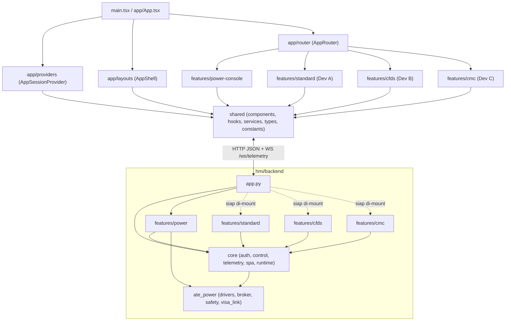

# Arsitektur Modular Berbasis Fitur (Feature-Based Modular Architecture)

Dokumen ini menjelaskan arsitektur web HMI pada direktori `hmi/` yang mendukung kontrol instrumen ATE (*Keysight N5746A* & *Keysight AC6803B*) serta fondasi pengembangan paralel untuk **Aeroflex JcAIR T1200 / T1200B Control Display Unit** (*Standard Mode*, *CFDS Mode*, *CMC Mode*).

---

## 1. Gambaran Umum Lapisan Aplikasi

### Frontend (`hmi/frontend/src/`)

| Lapisan | Lokasi | Tanggung Jawab |
| :--- | :--- | :--- |
| **App Shell & Wiring** | `src/app/` | Konfigurasi mode (`configuration/`), state provider sesi/telemetri (`providers/`), layout global (`layouts/`), dan routing (`router/`). |
| **Feature Modules** | `src/features/<module>/` | Modul independen per fitur/mode (`power-console`, `standard`, `cfds`, `cmc`), masing-masing memiliki `components/`, `pages/`, `hooks/`, `services/`, `types/`, `utils/`, `config/`, dan `index.ts`. |
| **Shared Layer** | `src/shared/` | Komponen UI reusable (`Meter`, `StripChart`, `SetpointInput`, `ConfirmModal`, `StatusPill`, `LogViewer`, `LoginView`), hooks (`useAuthSession`, `useControlLease`, `useTelemetryStream`, `useCommandAction`, `useAppSession`), HTTP/WS client, serta tipe kontrak bersama. |
| **Styles** | `src/styles/` | Token warna/tipografi (`tokens.css`) dan styling layout/komponen (`global.css`). |

### Backend (`hmi/backend/`)

| Lapisan | Lokasi | Tanggung Jawab |
| :--- | :--- | :--- |
| **Composition Root** | `app.py` | Inisialisasi FastAPI, `lifespan`, registrasi router, dan SPA static fallback. |
| **Core Shared** | `core/` | Runtime singleton (`broker`, `lease`), dependency auth/control (`require_session`, `require_control`), router inti (`/api/auth/*`, `/api/control/*`, `/api/state`, `/ws/telemetry`), serta serving SPA (`spa.py`). |
| **Feature Routers** | `features/<module>/` | Endpoint & service per modul (`power` untuk `/api/dc/*`, `/api/ac/*`, `/api/estop`, `/api/gpib/rescan`, `/api/mode/simulation`; serta kerangka independen `standard`, `cfds`, `cmc`). |
| **Hardware & Interlocks** | `ate_power/` | Driver SCPI/VISA + simulasi, safety interlocks, broker antrean tunggal, dan lease manager (juga dipakai oleh desktop fallback `gui/`). |

---

## 2. Diagram Hubungan Antar-Modul

---

## 3. Aturan Dependency (Dependency Rules)

1. **Aliran dependency satu arah:**
   - Frontend: `app` → `features/*` → `shared/*`
   - Backend: `app.py` → `features/*` → `core/*` → `ate_power/*`
2. **Dilarang impor lintas-fitur langsung:**
   - `features/standard/*` tidak boleh mengimpor file internal `features/cfds/*`, `features/cmc/*`, atau `features/power-console/*`.
   - Di backend, `features/<mode_a>/` tidak boleh mengimpor internal `features/<mode_b>/`.
3. **Dilarang impor ke lapisan atas:**
   - `shared/*` tidak boleh mengimpor `features/*` atau `app/*`.
   - `features/*` tidak boleh mengimpor `app/*`.
   - `core/*` di backend tidak boleh mengimpor `features/*`.
4. **Public Barrel Exports:**
   - Konsumen luar modul (seperti `app/router/AppRouter.tsx` atau `app.py`) hanya mengimpor dari `index.ts` / `__init__.py` modul terkait.
5. **Bebas Circular Dependency:**
   - Komunikasi antar-lapisan menggunakan kontrak tipe di `shared/types/` dan konteks `useAppSession` yang didefinisikan di `shared/hooks/`.

